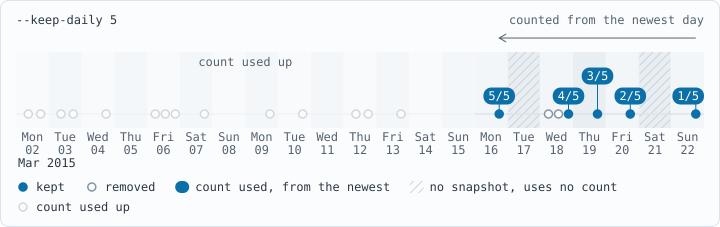
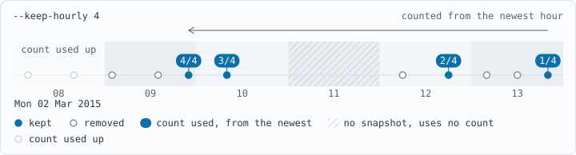
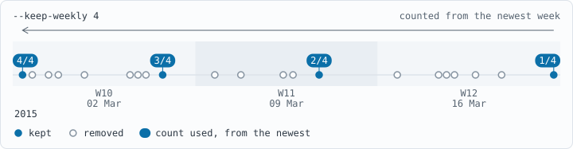
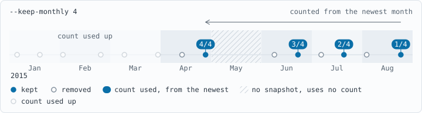
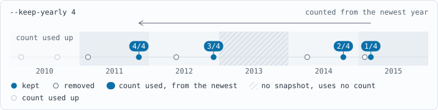
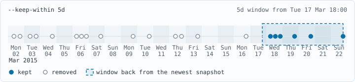
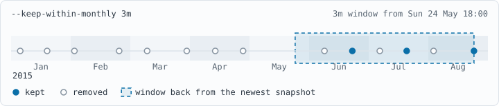

[//]: # (Generated from scripts/retentiondocs/retention.md.tmpl by task docs:gen. Edit the template.)

# Retention policies

`ark forget` keeps the snapshots a policy selects and removes the rest. The examples on this page are computed by ark itself: each shows a history of snapshots, what one rule keeps of it and the reasons `ark forget --json` gives.

The examples count hours, days, weeks, months and years in UTC; ark counts them in the local time zone of the machine that runs forget. A policy applies to each series on its own. Time zones, summer time, ISO weeks and series are covered in the [forget reference](cli/commands.md#forget).

In short:

- A counted rule such as `--keep-daily N` counts periods, not snapshots: it keeps the newest snapshot of each of the N most recent days that have one. A day without a snapshot uses no count, and of a day with several only the newest counts.
- When a counted rule reaches the oldest snapshot of the history with count left, it keeps that snapshot too.
- A within rule such as `--keep-within 7d` measures its window back from the newest snapshot, not from the time forget runs.
- A snapshot that any rule keeps stays.

Most examples share one history of three weeks, with days without a backup and days with several. Hourly, monthly and yearly rules and `--keep-tag` get histories of their own.

## Keep last

`--keep-last N` keeps the N newest snapshots, counted one by one: several snapshots of one day each use a count.

| Snapshot | Result | Reason |
|---|---|---|
| Sun 22 Mar 18:00 | kept | `last snapshot` |
| Fri 20 Mar 18:00 | kept | `last snapshot` |
| Thu 19 Mar 18:00 | kept | `last snapshot` |
| Wed 18 Mar 18:00 | kept | `last snapshot` |
| Wed 18 Mar 13:00 | kept | `last snapshot` |
| Wed 18 Mar 08:00 | removed | |
| Mon 16 Mar 18:00 | removed | |
| Fri 13 Mar 18:00 | removed | |
| Thu 12 Mar 18:00 | removed | |
| Thu 12 Mar 09:00 | removed | |
| Tue 10 Mar 18:00 | removed | |
| Mon 09 Mar 18:00 | removed | |
| Sat 07 Mar 18:00 | removed | |
| Fri 06 Mar 23:00 | removed | |
| Fri 06 Mar 18:00 | removed | |
| Fri 06 Mar 12:00 | removed | |
| Wed 04 Mar 18:00 | removed | |
| Tue 03 Mar 18:00 | removed | |
| Tue 03 Mar 09:00 | removed | |
| Mon 02 Mar 18:00 | removed | |
| Mon 02 Mar 09:00 | removed | |

`--keep-last 5` keeps Sun 22 Mar 18:00, Fri 20 Mar 18:00, Thu 19 Mar 18:00, Wed 18 Mar 18:00 and Wed 18 Mar 13:00 and removes 16 other snapshots.

## Keep hourly, daily, weekly, monthly, yearly

These rules count periods. Each keeps the newest snapshot of a period, newest period first, until its count is used up. A week is an ISO week and starts on Monday.

### Keep daily

`--keep-daily N` keeps the newest snapshot of each of the N most recent days that have a snapshot. It is not one snapshot a day for N days: days without a backup are skipped, so the rule reaches back as far as it takes to find N days.

| Snapshot | Result | Reason |
|---|---|---|
| Sun 22 Mar 18:00 | kept | `daily snapshot` |
| Fri 20 Mar 18:00 | kept | `daily snapshot` |
| Thu 19 Mar 18:00 | kept | `daily snapshot` |
| Wed 18 Mar 18:00 | kept | `daily snapshot` |
| Wed 18 Mar 13:00 | removed | |
| Wed 18 Mar 08:00 | removed | |
| Mon 16 Mar 18:00 | kept | `daily snapshot` |
| Fri 13 Mar 18:00 | removed | |
| Thu 12 Mar 18:00 | removed | |
| Thu 12 Mar 09:00 | removed | |
| Tue 10 Mar 18:00 | removed | |
| Mon 09 Mar 18:00 | removed | |
| Sat 07 Mar 18:00 | removed | |
| Fri 06 Mar 23:00 | removed | |
| Fri 06 Mar 18:00 | removed | |
| Fri 06 Mar 12:00 | removed | |
| Wed 04 Mar 18:00 | removed | |
| Tue 03 Mar 18:00 | removed | |
| Tue 03 Mar 09:00 | removed | |
| Mon 02 Mar 18:00 | removed | |
| Mon 02 Mar 09:00 | removed | |

`--keep-daily 5` keeps Sun 22 Mar 18:00, Fri 20 Mar 18:00, Thu 19 Mar 18:00, Wed 18 Mar 18:00 and Mon 16 Mar 18:00 and removes 16 other snapshots. No snapshot falls on Sat 21 Mar and Tue 17 Mar; a day without one uses no count.

### Keep hourly

`--keep-hourly N` keeps the newest snapshot of each of the N most recent hours that have one.

| Snapshot | Result | Reason |
|---|---|---|
| Mon 02 Mar 13:50 | kept | `hourly snapshot` |
| Mon 02 Mar 13:30 | removed | |
| Mon 02 Mar 13:10 | removed | |
| Mon 02 Mar 12:45 | kept | `hourly snapshot` |
| Mon 02 Mar 12:15 | removed | |
| Mon 02 Mar 10:20 | kept | `hourly snapshot` |
| Mon 02 Mar 09:55 | kept | `hourly snapshot` |
| Mon 02 Mar 09:35 | removed | |
| Mon 02 Mar 09:05 | removed | |
| Mon 02 Mar 08:40 | removed | |
| Mon 02 Mar 08:10 | removed | |

`--keep-hourly 4` keeps Mon 02 Mar 13:50, Mon 02 Mar 12:45, Mon 02 Mar 10:20 and Mon 02 Mar 09:55 and removes 7 other snapshots. No snapshot falls in the hour from 11:00; it uses no count.

### Keep weekly

`--keep-weekly N` keeps the newest snapshot of each of the N most recent weeks that have one.

| Snapshot | Result | Reason |
|---|---|---|
| Sun 22 Mar 18:00 | kept | `weekly snapshot` |
| Fri 20 Mar 18:00 | removed | |
| Thu 19 Mar 18:00 | removed | |
| Wed 18 Mar 18:00 | removed | |
| Wed 18 Mar 13:00 | removed | |
| Wed 18 Mar 08:00 | removed | |
| Mon 16 Mar 18:00 | removed | |
| Fri 13 Mar 18:00 | kept | `weekly snapshot` |
| Thu 12 Mar 18:00 | removed | |
| Thu 12 Mar 09:00 | removed | |
| Tue 10 Mar 18:00 | removed | |
| Mon 09 Mar 18:00 | removed | |
| Sat 07 Mar 18:00 | kept | `weekly snapshot` |
| Fri 06 Mar 23:00 | removed | |
| Fri 06 Mar 18:00 | removed | |
| Fri 06 Mar 12:00 | removed | |
| Wed 04 Mar 18:00 | removed | |
| Tue 03 Mar 18:00 | removed | |
| Tue 03 Mar 09:00 | removed | |
| Mon 02 Mar 18:00 | removed | |
| Mon 02 Mar 09:00 | kept | `oldest weekly snapshot` |

`--keep-weekly 4` keeps Sun 22 Mar 18:00, Fri 13 Mar 18:00, Sat 07 Mar 18:00 and Mon 02 Mar 09:00 and removes 17 other snapshots. The history ends before the count is used up, so the rule also keeps the oldest snapshot, Mon 02 Mar 09:00, although its week is taken; `--json` gives it an `oldest` reason.

### Keep monthly

`--keep-monthly N` keeps the newest snapshot of each of the N most recent months that have one.

| Snapshot | Result | Reason |
|---|---|---|
| Mon 24 Aug 18:00 | kept | `monthly snapshot` |
| Mon 03 Aug 18:00 | removed | |
| Mon 20 Jul 18:00 | kept | `monthly snapshot` |
| Mon 06 Jul 18:00 | removed | |
| Mon 22 Jun 18:00 | kept | `monthly snapshot` |
| Mon 08 Jun 18:00 | removed | |
| Mon 27 Apr 18:00 | kept | `monthly snapshot` |
| Mon 13 Apr 18:00 | removed | |
| Mon 30 Mar 18:00 | removed | |
| Mon 09 Mar 18:00 | removed | |
| Mon 23 Feb 18:00 | removed | |
| Mon 02 Feb 18:00 | removed | |
| Mon 19 Jan 18:00 | removed | |
| Mon 05 Jan 18:00 | removed | |

`--keep-monthly 4` keeps Mon 24 Aug 18:00, Mon 20 Jul 18:00, Mon 22 Jun 18:00 and Mon 27 Apr 18:00 and removes 10 other snapshots. No snapshot falls in May; a month without one uses no count.

### Keep yearly

`--keep-yearly N` keeps the newest snapshot of each of the N most recent years that have one.

| Snapshot | Result | Reason |
|---|---|---|
| Mon 02 Mar 2015 18:00 | kept | `yearly snapshot` |
| Mon 02 Feb 2015 18:00 | removed | |
| Mon 13 Oct 2014 18:00 | kept | `yearly snapshot` |
| Mon 07 Apr 2014 18:00 | removed | |
| Mon 03 Dec 2012 18:00 | kept | `yearly snapshot` |
| Mon 21 May 2012 18:00 | removed | |
| Mon 07 Nov 2011 18:00 | kept | `yearly snapshot` |
| Mon 14 Feb 2011 18:00 | removed | |
| Mon 06 Sep 2010 18:00 | removed | |
| Mon 01 Mar 2010 18:00 | removed | |

`--keep-yearly 4` keeps Mon 02 Mar 2015 18:00, Mon 13 Oct 2014 18:00, Mon 03 Dec 2012 18:00 and Mon 07 Nov 2011 18:00 and removes 6 other snapshots. No snapshot falls in 2013; a year without one uses no count.

### Unlimited

Every counted rule takes `unlimited` as its count: `--keep-daily unlimited` keeps the newest snapshot of every day that has one, and the oldest snapshot of the history always stays.

| Snapshot | Result | Reason |
|---|---|---|
| Sun 22 Mar 18:00 | kept | `daily snapshot` |
| Fri 20 Mar 18:00 | kept | `daily snapshot` |
| Thu 19 Mar 18:00 | kept | `daily snapshot` |
| Wed 18 Mar 18:00 | kept | `daily snapshot` |
| Wed 18 Mar 13:00 | removed | |
| Wed 18 Mar 08:00 | removed | |
| Mon 16 Mar 18:00 | kept | `daily snapshot` |
| Fri 13 Mar 18:00 | kept | `daily snapshot` |
| Thu 12 Mar 18:00 | kept | `daily snapshot` |
| Thu 12 Mar 09:00 | removed | |
| Tue 10 Mar 18:00 | kept | `daily snapshot` |
| Mon 09 Mar 18:00 | kept | `daily snapshot` |
| Sat 07 Mar 18:00 | kept | `daily snapshot` |
| Fri 06 Mar 23:00 | kept | `daily snapshot` |
| Fri 06 Mar 18:00 | removed | |
| Fri 06 Mar 12:00 | removed | |
| Wed 04 Mar 18:00 | kept | `daily snapshot` |
| Tue 03 Mar 18:00 | kept | `daily snapshot` |
| Tue 03 Mar 09:00 | removed | |
| Mon 02 Mar 18:00 | kept | `daily snapshot` |
| Mon 02 Mar 09:00 | kept | `oldest daily snapshot` |

`--keep-daily unlimited` keeps Sun 22 Mar 18:00, Fri 20 Mar 18:00, Thu 19 Mar 18:00, Wed 18 Mar 18:00, Mon 16 Mar 18:00, Fri 13 Mar 18:00, Thu 12 Mar 18:00, Tue 10 Mar 18:00, Mon 09 Mar 18:00, Sat 07 Mar 18:00, Fri 06 Mar 23:00, Wed 04 Mar 18:00, Tue 03 Mar 18:00, Mon 02 Mar 18:00 and Mon 02 Mar 09:00 and removes 6 other snapshots. The oldest snapshot, Mon 02 Mar 09:00, stays although its day is taken.

## Keep within

### Keep within a duration

`--keep-within DURATION` keeps every snapshot younger than the duration, however many there are. The window ends at the newest snapshot, so a history that stopped receiving backups keeps its last ones. A snapshot exactly the duration old is outside.

| Snapshot | Result | Reason |
|---|---|---|
| Sun 22 Mar 18:00 | kept | `within 5d` |
| Fri 20 Mar 18:00 | kept | `within 5d` |
| Thu 19 Mar 18:00 | kept | `within 5d` |
| Wed 18 Mar 18:00 | kept | `within 5d` |
| Wed 18 Mar 13:00 | kept | `within 5d` |
| Wed 18 Mar 08:00 | kept | `within 5d` |
| Mon 16 Mar 18:00 | removed | |
| Fri 13 Mar 18:00 | removed | |
| Thu 12 Mar 18:00 | removed | |
| Thu 12 Mar 09:00 | removed | |
| Tue 10 Mar 18:00 | removed | |
| Mon 09 Mar 18:00 | removed | |
| Sat 07 Mar 18:00 | removed | |
| Fri 06 Mar 23:00 | removed | |
| Fri 06 Mar 18:00 | removed | |
| Fri 06 Mar 12:00 | removed | |
| Wed 04 Mar 18:00 | removed | |
| Tue 03 Mar 18:00 | removed | |
| Tue 03 Mar 09:00 | removed | |
| Mon 02 Mar 18:00 | removed | |
| Mon 02 Mar 09:00 | removed | |

`--keep-within 5d` keeps Sun 22 Mar 18:00, Fri 20 Mar 18:00, Thu 19 Mar 18:00, Wed 18 Mar 18:00, Wed 18 Mar 13:00 and Wed 18 Mar 08:00 and removes 15 other snapshots. The window starts at Tue 17 Mar 18:00.

### Keep the newest of every period within a duration

`--keep-within-hourly`, `--keep-within-daily`, `--keep-within-weekly`, `--keep-within-monthly` and `--keep-within-yearly` take a duration in place of a count: they keep the newest snapshot of every period that has one inside the window, however many periods that is.

| Snapshot | Result | Reason |
|---|---|---|
| Mon 02 Mar 13:50 | kept | `hourly within 3h` |
| Mon 02 Mar 13:30 | removed | |
| Mon 02 Mar 13:10 | removed | |
| Mon 02 Mar 12:45 | kept | `hourly within 3h` |
| Mon 02 Mar 12:15 | removed | |
| Mon 02 Mar 10:20 | removed | |
| Mon 02 Mar 09:55 | removed | |
| Mon 02 Mar 09:35 | removed | |
| Mon 02 Mar 09:05 | removed | |
| Mon 02 Mar 08:40 | removed | |
| Mon 02 Mar 08:10 | removed | |

`--keep-within-hourly 3h` keeps Mon 02 Mar 13:50 and Mon 02 Mar 12:45 and removes 9 other snapshots. The window starts at Mon 02 Mar 10:50.

| Snapshot | Result | Reason |
|---|---|---|
| Sun 22 Mar 18:00 | kept | `daily within 7d` |
| Fri 20 Mar 18:00 | kept | `daily within 7d` |
| Thu 19 Mar 18:00 | kept | `daily within 7d` |
| Wed 18 Mar 18:00 | kept | `daily within 7d` |
| Wed 18 Mar 13:00 | removed | |
| Wed 18 Mar 08:00 | removed | |
| Mon 16 Mar 18:00 | kept | `daily within 7d` |
| Fri 13 Mar 18:00 | removed | |
| Thu 12 Mar 18:00 | removed | |
| Thu 12 Mar 09:00 | removed | |
| Tue 10 Mar 18:00 | removed | |
| Mon 09 Mar 18:00 | removed | |
| Sat 07 Mar 18:00 | removed | |
| Fri 06 Mar 23:00 | removed | |
| Fri 06 Mar 18:00 | removed | |
| Fri 06 Mar 12:00 | removed | |
| Wed 04 Mar 18:00 | removed | |
| Tue 03 Mar 18:00 | removed | |
| Tue 03 Mar 09:00 | removed | |
| Mon 02 Mar 18:00 | removed | |
| Mon 02 Mar 09:00 | removed | |

`--keep-within-daily 7d` keeps Sun 22 Mar 18:00, Fri 20 Mar 18:00, Thu 19 Mar 18:00, Wed 18 Mar 18:00 and Mon 16 Mar 18:00 and removes 16 other snapshots. The window starts at Sun 15 Mar 18:00.

| Snapshot | Result | Reason |
|---|---|---|
| Sun 22 Mar 18:00 | kept | `weekly within 14d` |
| Fri 20 Mar 18:00 | removed | |
| Thu 19 Mar 18:00 | removed | |
| Wed 18 Mar 18:00 | removed | |
| Wed 18 Mar 13:00 | removed | |
| Wed 18 Mar 08:00 | removed | |
| Mon 16 Mar 18:00 | removed | |
| Fri 13 Mar 18:00 | kept | `weekly within 14d` |
| Thu 12 Mar 18:00 | removed | |
| Thu 12 Mar 09:00 | removed | |
| Tue 10 Mar 18:00 | removed | |
| Mon 09 Mar 18:00 | removed | |
| Sat 07 Mar 18:00 | removed | |
| Fri 06 Mar 23:00 | removed | |
| Fri 06 Mar 18:00 | removed | |
| Fri 06 Mar 12:00 | removed | |
| Wed 04 Mar 18:00 | removed | |
| Tue 03 Mar 18:00 | removed | |
| Tue 03 Mar 09:00 | removed | |
| Mon 02 Mar 18:00 | removed | |
| Mon 02 Mar 09:00 | removed | |

`--keep-within-weekly 14d` keeps Sun 22 Mar 18:00 and Fri 13 Mar 18:00 and removes 19 other snapshots. The window starts at Sun 08 Mar 18:00.

| Snapshot | Result | Reason |
|---|---|---|
| Mon 24 Aug 18:00 | kept | `monthly within 3m` |
| Mon 03 Aug 18:00 | removed | |
| Mon 20 Jul 18:00 | kept | `monthly within 3m` |
| Mon 06 Jul 18:00 | removed | |
| Mon 22 Jun 18:00 | kept | `monthly within 3m` |
| Mon 08 Jun 18:00 | removed | |
| Mon 27 Apr 18:00 | removed | |
| Mon 13 Apr 18:00 | removed | |
| Mon 30 Mar 18:00 | removed | |
| Mon 09 Mar 18:00 | removed | |
| Mon 23 Feb 18:00 | removed | |
| Mon 02 Feb 18:00 | removed | |
| Mon 19 Jan 18:00 | removed | |
| Mon 05 Jan 18:00 | removed | |

`--keep-within-monthly 3m` keeps Mon 24 Aug 18:00, Mon 20 Jul 18:00 and Mon 22 Jun 18:00 and removes 11 other snapshots. The window starts at Sun 24 May 18:00.

| Snapshot | Result | Reason |
|---|---|---|
| Mon 02 Mar 2015 18:00 | kept | `yearly within 3y` |
| Mon 02 Feb 2015 18:00 | removed | |
| Mon 13 Oct 2014 18:00 | kept | `yearly within 3y` |
| Mon 07 Apr 2014 18:00 | removed | |
| Mon 03 Dec 2012 18:00 | kept | `yearly within 3y` |
| Mon 21 May 2012 18:00 | removed | |
| Mon 07 Nov 2011 18:00 | removed | |
| Mon 14 Feb 2011 18:00 | removed | |
| Mon 06 Sep 2010 18:00 | removed | |
| Mon 01 Mar 2010 18:00 | removed | |

`--keep-within-yearly 3y` keeps Mon 02 Mar 2015 18:00, Mon 13 Oct 2014 18:00 and Mon 03 Dec 2012 18:00 and removes 7 other snapshots. The window starts at Fri 02 Mar 2012 18:00.

## Keep tag

`--keep-tag TAG` keeps every snapshot that carries the tag, whatever its age. It has no count and no period, and on its own it keeps nothing else, not even the newest snapshot. The history is a week of daily backups, some of them tagged `release`.

| Snapshot | Result | Reason |
|---|---|---|
| Sun 08 Mar 18:00 | removed | |
| Sat 07 Mar 18:00 | removed | |
| Fri 06 Mar 18:00 | kept | `has tags [release]` |
| Thu 05 Mar 18:00 | removed | |
| Wed 04 Mar 18:00 | removed | |
| Tue 03 Mar 18:00 | kept | `has tags [release]` |
| Mon 02 Mar 18:00 | removed | |

`--keep-tag release` keeps Fri 06 Mar 18:00 and Tue 03 Mar 18:00 and removes 5 other snapshots.
