[//]: # (Generated from scripts/retentiondocs/retention.md.tmpl by task docs:gen. Edit the template.)

# Retention policies

A retention policy tells `ark forget` which snapshots to keep. It removes the rest. This page shows every rule on a timeline, so you can see what a policy does before you run it.

The examples are computed by ark itself. Each one takes a history of snapshots, applies a policy, and shows what stays, with the reasons that `ark forget --json` gives.

## The rules in brief

| Rule | Keeps |
|---|---|
| `--keep-last N` | the N newest snapshots |
| `--keep-hourly N`, `--keep-daily N`, `--keep-weekly N`, `--keep-monthly N`, `--keep-yearly N` | the newest snapshot of each of the N most recent hours, days, weeks, months, or years that have one |
| `--keep-within DURATION` | every snapshot younger than DURATION |
| `--keep-within-hourly DURATION` to `--keep-within-yearly DURATION` | the newest snapshot of every hour, day, week, month, or year younger than DURATION |
| `--keep-tag TAG` | every snapshot that carries the tag |

Five things are true for every policy:

- **Rules add up.** A snapshot that any rule keeps stays.
- **Each series is on its own.** A policy applies to every [series](series.md) separately.
- **Counted rules count periods, not snapshots.** `--keep-daily 7` keeps the newest snapshot of each of the 7 most recent days that have one. A day without a snapshot uses no count, and of a day with several, only the newest counts.
- **The oldest snapshot can stay too.** When a counted rule reaches the oldest snapshot with count left, it keeps that snapshot as well.
- **Windows are measured back from the newest snapshot.** `--keep-within 7d` covers the 7 days before the newest snapshot, not the 7 days before `ark forget` runs.

Before you run a policy for real, try it:

```bash
ark forget --keep-daily 7 --keep-weekly 4 --dry-run
```

The [command reference](cli/commands.md#forget) lists the flags and how the command behaves.

## How to read the examples

- Most examples share one history of three weeks, with days without a backup and days with several. Hourly, monthly, and yearly rules, `--keep-tag`, the long-horizon recipe, and the comparison of daily with hourly get histories of their own.
- The examples count hours, days, weeks, months, and years in UTC. ark counts them in the local time zone of the machine that runs `ark forget`, see [Time zones](#time-zones).
- Each example shows one series.

## Keep last

`--keep-last N` keeps the N newest snapshots. It counts snapshots one by one, so several snapshots of one day each use a count.

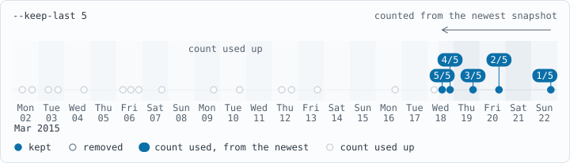

| Snapshot | Result | Reason |
|---|---|---|
| Sun 22 Mar 18:00 | kept | `last snapshot` |
| Fri 20 Mar 18:00 | kept | `last snapshot` |
| Fri 20 Mar 09:00 | kept | `last snapshot` |
| Thu 19 Mar 18:00 | kept | `last snapshot` |
| Wed 18 Mar 18:00 | kept | `last snapshot` |
| Wed 18 Mar 13:00 | removed | |
| Wed 18 Mar 08:00 | removed | |
| Mon 16 Mar 18:00 | removed | |
| Fri 13 Mar 18:00 | removed | |
| Thu 12 Mar 18:00 | removed | |
| Thu 12 Mar 09:00 | removed | |
| Tue 10 Mar 18:00 | removed | |
| Mon 09 Mar 18:00 | removed | |
| Sat 07 Mar 18:00 | removed | |
| Fri 06 Mar 23:00 | removed | |
| Fri 06 Mar 18:00 | removed | |
| Fri 06 Mar 12:00 | removed | |
| Wed 04 Mar 18:00 | removed | |
| Tue 03 Mar 18:00 | removed | |
| Tue 03 Mar 09:00 | removed | |
| Mon 02 Mar 18:00 | removed | |
| Mon 02 Mar 09:00 | removed | |

`--keep-last 5` keeps Sun 22 Mar 18:00, Fri 20 Mar 18:00, Fri 20 Mar 09:00, Thu 19 Mar 18:00 and Wed 18 Mar 18:00 and removes 17 other snapshots.

## Keep hourly, daily, weekly, monthly, yearly

These rules count periods. Each one keeps the newest snapshot of a period, newest period first, until its count is used up. A week is an ISO week and starts on Monday.

### Keep daily

`--keep-daily N` keeps the newest snapshot of each of the N most recent days that have a snapshot. That isn't the same as one snapshot a day for N days. Days without a backup are skipped, so the rule reaches back as far as it takes to find N days.


| Snapshot | Result | Reason |
|---|---|---|
| Sun 22 Mar 18:00 | kept | `daily snapshot` |
| Fri 20 Mar 18:00 | kept | `daily snapshot` |
| Fri 20 Mar 09:00 | removed | |
| Thu 19 Mar 18:00 | kept | `daily snapshot` |
| Wed 18 Mar 18:00 | kept | `daily snapshot` |
| Wed 18 Mar 13:00 | removed | |
| Wed 18 Mar 08:00 | removed | |
| Mon 16 Mar 18:00 | kept | `daily snapshot` |
| Fri 13 Mar 18:00 | removed | |
| Thu 12 Mar 18:00 | removed | |
| Thu 12 Mar 09:00 | removed | |
| Tue 10 Mar 18:00 | removed | |
| Mon 09 Mar 18:00 | removed | |
| Sat 07 Mar 18:00 | removed | |
| Fri 06 Mar 23:00 | removed | |
| Fri 06 Mar 18:00 | removed | |
| Fri 06 Mar 12:00 | removed | |
| Wed 04 Mar 18:00 | removed | |
| Tue 03 Mar 18:00 | removed | |
| Tue 03 Mar 09:00 | removed | |
| Mon 02 Mar 18:00 | removed | |
| Mon 02 Mar 09:00 | removed | |

`--keep-daily 5` keeps Sun 22 Mar 18:00, Fri 20 Mar 18:00, Thu 19 Mar 18:00, Wed 18 Mar 18:00 and Mon 16 Mar 18:00 and removes 17 other snapshots. No snapshot falls on Sat 21 Mar and Tue 17 Mar; a day without one uses no count.

### Keep hourly

`--keep-hourly N` keeps the newest snapshot of each of the N most recent hours that have one.


| Snapshot | Result | Reason |
|---|---|---|
| Mon 02 Mar 13:50 | kept | `hourly snapshot` |
| Mon 02 Mar 13:30 | removed | |
| Mon 02 Mar 13:10 | removed | |
| Mon 02 Mar 12:45 | kept | `hourly snapshot` |
| Mon 02 Mar 12:15 | removed | |
| Mon 02 Mar 10:20 | kept | `hourly snapshot` |
| Mon 02 Mar 09:55 | kept | `hourly snapshot` |
| Mon 02 Mar 09:35 | removed | |
| Mon 02 Mar 09:05 | removed | |
| Mon 02 Mar 08:40 | removed | |
| Mon 02 Mar 08:10 | removed | |

`--keep-hourly 4` keeps Mon 02 Mar 13:50, Mon 02 Mar 12:45, Mon 02 Mar 10:20 and Mon 02 Mar 09:55 and removes 7 other snapshots. No snapshot falls in the hour starting Mon 02 Mar 11:00; an hour without one uses no count.

### Keep weekly

`--keep-weekly N` keeps the newest snapshot of each of the N most recent weeks that have one.


| Snapshot | Result | Reason |
|---|---|---|
| Sun 22 Mar 18:00 | kept | `weekly snapshot` |
| Fri 20 Mar 18:00 | removed | |
| Fri 20 Mar 09:00 | removed | |
| Thu 19 Mar 18:00 | removed | |
| Wed 18 Mar 18:00 | removed | |
| Wed 18 Mar 13:00 | removed | |
| Wed 18 Mar 08:00 | removed | |
| Mon 16 Mar 18:00 | removed | |
| Fri 13 Mar 18:00 | kept | `weekly snapshot` |
| Thu 12 Mar 18:00 | removed | |
| Thu 12 Mar 09:00 | removed | |
| Tue 10 Mar 18:00 | removed | |
| Mon 09 Mar 18:00 | removed | |
| Sat 07 Mar 18:00 | kept | `weekly snapshot` |
| Fri 06 Mar 23:00 | removed | |
| Fri 06 Mar 18:00 | removed | |
| Fri 06 Mar 12:00 | removed | |
| Wed 04 Mar 18:00 | removed | |
| Tue 03 Mar 18:00 | removed | |
| Tue 03 Mar 09:00 | removed | |
| Mon 02 Mar 18:00 | removed | |
| Mon 02 Mar 09:00 | kept | `oldest weekly snapshot` |

`--keep-weekly 4` keeps Sun 22 Mar 18:00, Fri 13 Mar 18:00, Sat 07 Mar 18:00 and Mon 02 Mar 09:00 and removes 18 other snapshots. The history ends before the count is used up, so the rule also keeps the oldest snapshot, Mon 02 Mar 09:00, although its week is taken; `--json` gives it an `oldest` reason.

### Keep monthly

`--keep-monthly N` keeps the newest snapshot of each of the N most recent months that have one.


| Snapshot | Result | Reason |
|---|---|---|
| Mon 24 Aug 18:00 | kept | `monthly snapshot` |
| Mon 03 Aug 18:00 | removed | |
| Mon 20 Jul 18:00 | kept | `monthly snapshot` |
| Mon 06 Jul 18:00 | removed | |
| Mon 22 Jun 18:00 | kept | `monthly snapshot` |
| Mon 08 Jun 18:00 | removed | |
| Mon 27 Apr 18:00 | kept | `monthly snapshot` |
| Mon 13 Apr 18:00 | removed | |
| Mon 30 Mar 18:00 | removed | |
| Mon 09 Mar 18:00 | removed | |
| Mon 23 Feb 18:00 | removed | |
| Mon 02 Feb 18:00 | removed | |
| Mon 19 Jan 18:00 | removed | |
| Mon 05 Jan 18:00 | removed | |

`--keep-monthly 4` keeps Mon 24 Aug 18:00, Mon 20 Jul 18:00, Mon 22 Jun 18:00 and Mon 27 Apr 18:00 and removes 10 other snapshots. No snapshot falls in May; a month without one uses no count.

### Keep yearly

`--keep-yearly N` keeps the newest snapshot of each of the N most recent years that have one.


| Snapshot | Result | Reason |
|---|---|---|
| Mon 02 Mar 2015 18:00 | kept | `yearly snapshot` |
| Mon 02 Feb 2015 18:00 | removed | |
| Mon 13 Oct 2014 18:00 | kept | `yearly snapshot` |
| Mon 07 Apr 2014 18:00 | removed | |
| Mon 03 Dec 2012 18:00 | kept | `yearly snapshot` |
| Mon 21 May 2012 18:00 | removed | |
| Mon 07 Nov 2011 18:00 | kept | `yearly snapshot` |
| Mon 14 Feb 2011 18:00 | removed | |
| Mon 06 Sep 2010 18:00 | removed | |
| Mon 01 Mar 2010 18:00 | removed | |

`--keep-yearly 4` keeps Mon 02 Mar 2015 18:00, Mon 13 Oct 2014 18:00, Mon 03 Dec 2012 18:00 and Mon 07 Nov 2011 18:00 and removes 6 other snapshots. No snapshot falls in 2013; a year without one uses no count.

### Unlimited

Every counted rule takes `unlimited` as its count. `--keep-daily unlimited` keeps the newest snapshot of every day that has one. The oldest snapshot of the history always stays.

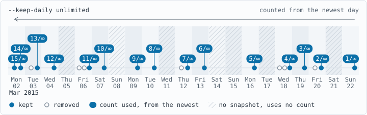

| Snapshot | Result | Reason |
|---|---|---|
| Sun 22 Mar 18:00 | kept | `daily snapshot` |
| Fri 20 Mar 18:00 | kept | `daily snapshot` |
| Fri 20 Mar 09:00 | removed | |
| Thu 19 Mar 18:00 | kept | `daily snapshot` |
| Wed 18 Mar 18:00 | kept | `daily snapshot` |
| Wed 18 Mar 13:00 | removed | |
| Wed 18 Mar 08:00 | removed | |
| Mon 16 Mar 18:00 | kept | `daily snapshot` |
| Fri 13 Mar 18:00 | kept | `daily snapshot` |
| Thu 12 Mar 18:00 | kept | `daily snapshot` |
| Thu 12 Mar 09:00 | removed | |
| Tue 10 Mar 18:00 | kept | `daily snapshot` |
| Mon 09 Mar 18:00 | kept | `daily snapshot` |
| Sat 07 Mar 18:00 | kept | `daily snapshot` |
| Fri 06 Mar 23:00 | kept | `daily snapshot` |
| Fri 06 Mar 18:00 | removed | |
| Fri 06 Mar 12:00 | removed | |
| Wed 04 Mar 18:00 | kept | `daily snapshot` |
| Tue 03 Mar 18:00 | kept | `daily snapshot` |
| Tue 03 Mar 09:00 | removed | |
| Mon 02 Mar 18:00 | kept | `daily snapshot` |
| Mon 02 Mar 09:00 | kept | `oldest daily snapshot` |

`--keep-daily unlimited` keeps Sun 22 Mar 18:00, Fri 20 Mar 18:00, Thu 19 Mar 18:00, Wed 18 Mar 18:00, Mon 16 Mar 18:00, Fri 13 Mar 18:00, Thu 12 Mar 18:00, Tue 10 Mar 18:00, Mon 09 Mar 18:00, Sat 07 Mar 18:00, Fri 06 Mar 23:00, Wed 04 Mar 18:00, Tue 03 Mar 18:00, Mon 02 Mar 18:00 and Mon 02 Mar 09:00 and removes 7 other snapshots. The oldest snapshot, Mon 02 Mar 09:00, stays although its day is taken.

### The oldest snapshot

A period rule works through the periods, newest first. When it reaches the oldest snapshot of a series and still has count left, it keeps that snapshot too, although its period is already taken.

For example, `--keep-daily 7` on a series that spans two days keeps the newest snapshot of each day, and the oldest snapshot. `--json` gives that one the reason `oldest daily snapshot`. The [weekly example](#keep-weekly) shows the rule at work.

The effect is that a series shorter than its policy keeps its first snapshot until the policy is filled. With `unlimited`, the oldest snapshot always stays.

`--keep-last` and `--keep-within` have no such rule. restic selects the same way.

## Keep within

The rules in this section take a duration instead of a count.

### Durations

A duration is written as whole numbers, each followed by a unit. Every unit appears at most once, in this order:

| Unit | Meaning |
|---|---|
| `y` | years |
| `m` | months, at most 11 |
| `d` | days |
| `h` | hours |

`30d`, `72h`, `1y6m`, and `1y2m3d4h` are durations.

- There are no minutes, seconds, or weeks, and no fractions.
- A number can be at most a million, and a duration of zero is refused.
- `m` always means months. `90m` is neither 90 minutes nor seven and a half years: it's a usage error. Write 18 months as `1y6m`.
- Years, months, and days are steps on the calendar. Hours are elapsed time. [Calendar steps](#details-calendar-steps) has the cases where that matters.

These are restic's units.

### Keep within a duration

`--keep-within DURATION` keeps every snapshot younger than the duration, however many there are.

The window is measured back from the newest snapshot of the series, not from the time of the run. A series that stopped receiving backups therefore keeps its last snapshots. A snapshot that is exactly the duration old is outside the window.


| Snapshot | Result | Reason |
|---|---|---|
| Sun 22 Mar 18:00 | kept | `within 5d` |
| Fri 20 Mar 18:00 | kept | `within 5d` |
| Fri 20 Mar 09:00 | kept | `within 5d` |
| Thu 19 Mar 18:00 | kept | `within 5d` |
| Wed 18 Mar 18:00 | kept | `within 5d` |
| Wed 18 Mar 13:00 | kept | `within 5d` |
| Wed 18 Mar 08:00 | kept | `within 5d` |
| Mon 16 Mar 18:00 | removed | |
| Fri 13 Mar 18:00 | removed | |
| Thu 12 Mar 18:00 | removed | |
| Thu 12 Mar 09:00 | removed | |
| Tue 10 Mar 18:00 | removed | |
| Mon 09 Mar 18:00 | removed | |
| Sat 07 Mar 18:00 | removed | |
| Fri 06 Mar 23:00 | removed | |
| Fri 06 Mar 18:00 | removed | |
| Fri 06 Mar 12:00 | removed | |
| Wed 04 Mar 18:00 | removed | |
| Tue 03 Mar 18:00 | removed | |
| Tue 03 Mar 09:00 | removed | |
| Mon 02 Mar 18:00 | removed | |
| Mon 02 Mar 09:00 | removed | |

`--keep-within 5d` keeps Sun 22 Mar 18:00, Fri 20 Mar 18:00, Fri 20 Mar 09:00, Thu 19 Mar 18:00, Wed 18 Mar 18:00, Wed 18 Mar 13:00 and Wed 18 Mar 08:00 and removes 15 other snapshots. The window starts at Tue 17 Mar 18:00.

### Keep the newest of every period within a duration

`--keep-within-hourly`, `--keep-within-daily`, `--keep-within-weekly`, `--keep-within-monthly`, and `--keep-within-yearly` are the period rules with a duration in place of a count. `--keep-within-daily 14d` keeps the newest snapshot of every day of the last 14 days, however many of those days have one.

- The window is measured like the one of `--keep-within`.
- The periods are those of the counted rules.
- Each rule has its own duration and decides by itself.
- When the oldest snapshot of the history lies inside the window and shares its period with a newer one, the rule keeps it too. Its reason then starts with `oldest`, as in `oldest daily within 30d`.

restic selects the same way.

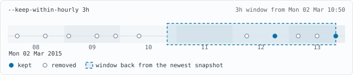

| Snapshot | Result | Reason |
|---|---|---|
| Mon 02 Mar 13:50 | kept | `hourly within 3h` |
| Mon 02 Mar 13:30 | removed | |
| Mon 02 Mar 13:10 | removed | |
| Mon 02 Mar 12:45 | kept | `hourly within 3h` |
| Mon 02 Mar 12:15 | removed | |
| Mon 02 Mar 10:20 | removed | |
| Mon 02 Mar 09:55 | removed | |
| Mon 02 Mar 09:35 | removed | |
| Mon 02 Mar 09:05 | removed | |
| Mon 02 Mar 08:40 | removed | |
| Mon 02 Mar 08:10 | removed | |

`--keep-within-hourly 3h` keeps Mon 02 Mar 13:50 and Mon 02 Mar 12:45 and removes 9 other snapshots. The window starts at Mon 02 Mar 10:50.

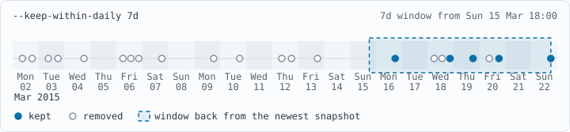

| Snapshot | Result | Reason |
|---|---|---|
| Sun 22 Mar 18:00 | kept | `daily within 7d` |
| Fri 20 Mar 18:00 | kept | `daily within 7d` |
| Fri 20 Mar 09:00 | removed | |
| Thu 19 Mar 18:00 | kept | `daily within 7d` |
| Wed 18 Mar 18:00 | kept | `daily within 7d` |
| Wed 18 Mar 13:00 | removed | |
| Wed 18 Mar 08:00 | removed | |
| Mon 16 Mar 18:00 | kept | `daily within 7d` |
| Fri 13 Mar 18:00 | removed | |
| Thu 12 Mar 18:00 | removed | |
| Thu 12 Mar 09:00 | removed | |
| Tue 10 Mar 18:00 | removed | |
| Mon 09 Mar 18:00 | removed | |
| Sat 07 Mar 18:00 | removed | |
| Fri 06 Mar 23:00 | removed | |
| Fri 06 Mar 18:00 | removed | |
| Fri 06 Mar 12:00 | removed | |
| Wed 04 Mar 18:00 | removed | |
| Tue 03 Mar 18:00 | removed | |
| Tue 03 Mar 09:00 | removed | |
| Mon 02 Mar 18:00 | removed | |
| Mon 02 Mar 09:00 | removed | |

`--keep-within-daily 7d` keeps Sun 22 Mar 18:00, Fri 20 Mar 18:00, Thu 19 Mar 18:00, Wed 18 Mar 18:00 and Mon 16 Mar 18:00 and removes 17 other snapshots. The window starts at Sun 15 Mar 18:00.

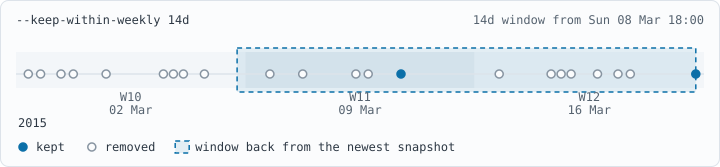

| Snapshot | Result | Reason |
|---|---|---|
| Sun 22 Mar 18:00 | kept | `weekly within 14d` |
| Fri 20 Mar 18:00 | removed | |
| Fri 20 Mar 09:00 | removed | |
| Thu 19 Mar 18:00 | removed | |
| Wed 18 Mar 18:00 | removed | |
| Wed 18 Mar 13:00 | removed | |
| Wed 18 Mar 08:00 | removed | |
| Mon 16 Mar 18:00 | removed | |
| Fri 13 Mar 18:00 | kept | `weekly within 14d` |
| Thu 12 Mar 18:00 | removed | |
| Thu 12 Mar 09:00 | removed | |
| Tue 10 Mar 18:00 | removed | |
| Mon 09 Mar 18:00 | removed | |
| Sat 07 Mar 18:00 | removed | |
| Fri 06 Mar 23:00 | removed | |
| Fri 06 Mar 18:00 | removed | |
| Fri 06 Mar 12:00 | removed | |
| Wed 04 Mar 18:00 | removed | |
| Tue 03 Mar 18:00 | removed | |
| Tue 03 Mar 09:00 | removed | |
| Mon 02 Mar 18:00 | removed | |
| Mon 02 Mar 09:00 | removed | |

`--keep-within-weekly 14d` keeps Sun 22 Mar 18:00 and Fri 13 Mar 18:00 and removes 20 other snapshots. The window starts at Sun 08 Mar 18:00.


| Snapshot | Result | Reason |
|---|---|---|
| Mon 24 Aug 18:00 | kept | `monthly within 3m` |
| Mon 03 Aug 18:00 | removed | |
| Mon 20 Jul 18:00 | kept | `monthly within 3m` |
| Mon 06 Jul 18:00 | removed | |
| Mon 22 Jun 18:00 | kept | `monthly within 3m` |
| Mon 08 Jun 18:00 | removed | |
| Mon 27 Apr 18:00 | removed | |
| Mon 13 Apr 18:00 | removed | |
| Mon 30 Mar 18:00 | removed | |
| Mon 09 Mar 18:00 | removed | |
| Mon 23 Feb 18:00 | removed | |
| Mon 02 Feb 18:00 | removed | |
| Mon 19 Jan 18:00 | removed | |
| Mon 05 Jan 18:00 | removed | |

`--keep-within-monthly 3m` keeps Mon 24 Aug 18:00, Mon 20 Jul 18:00 and Mon 22 Jun 18:00 and removes 11 other snapshots. The window starts at Sun 24 May 18:00.

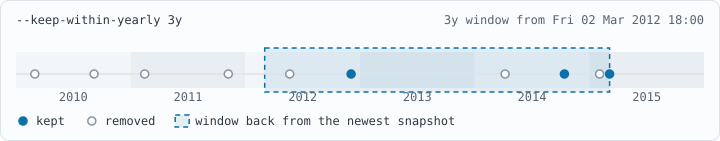

| Snapshot | Result | Reason |
|---|---|---|
| Mon 02 Mar 2015 18:00 | kept | `yearly within 3y` |
| Mon 02 Feb 2015 18:00 | removed | |
| Mon 13 Oct 2014 18:00 | kept | `yearly within 3y` |
| Mon 07 Apr 2014 18:00 | removed | |
| Mon 03 Dec 2012 18:00 | kept | `yearly within 3y` |
| Mon 21 May 2012 18:00 | removed | |
| Mon 07 Nov 2011 18:00 | removed | |
| Mon 14 Feb 2011 18:00 | removed | |
| Mon 06 Sep 2010 18:00 | removed | |
| Mon 01 Mar 2010 18:00 | removed | |

`--keep-within-yearly 3y` keeps Mon 02 Mar 2015 18:00, Mon 13 Oct 2014 18:00 and Mon 03 Dec 2012 18:00 and removes 7 other snapshots. The window starts at Fri 02 Mar 2012 18:00.

## Keep tag

`--keep-tag TAG` keeps every snapshot that carries the tag, whatever its age.

- One value can list several tags, separated by commas. A snapshot has to carry all of them: `--keep-tag db,prod`.
- You can give the flag several times. A snapshot that matches any of the lists stays.
- `--keep-tag ''` keeps the snapshots without a tag.
- Blanks around a tag are dropped.
- The reason in `--json` reads `has tags [db, prod]`.

The rule has no count and no period. On its own, it keeps nothing else, not even the newest snapshot. That makes it the one rule that can leave a series without any snapshot, and ark refuses to do that. `ark forget` then removes nothing, of no series, and exits 1 naming the series. `--dry-run` fails the same way and prints no list. restic refuses the same way.

If you get that error, do one of these:

- Narrow the filters to the series that carry the tag.
- Add a rule that always keeps something, such as `--keep-last 1`.
- Remove a series on purpose with a filter and `--all`.

The history below is a week of daily backups, some of them tagged `release`.

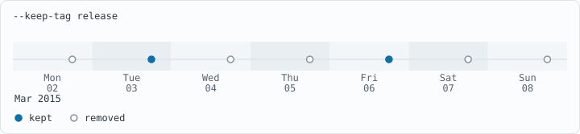

| Snapshot | Result | Reason |
|---|---|---|
| Sun 08 Mar 18:00 | removed | |
| Sat 07 Mar 18:00 | removed | |
| Fri 06 Mar 18:00 | kept | `has tags [release]` |
| Thu 05 Mar 18:00 | removed | |
| Wed 04 Mar 18:00 | removed | |
| Tue 03 Mar 18:00 | kept | `has tags [release]` |
| Mon 02 Mar 18:00 | removed | |

`--keep-tag release` keeps Fri 06 Mar 18:00 and Tue 03 Mar 18:00 and removes 5 other snapshots.

## Combining rules

A policy of several rules keeps a snapshot when any of its rules keeps it, and removes only what none of them keeps. Each rule counts on its own over the whole history. A snapshot that two rules keep uses a count of each, and `--json` gives a reason for each.

In a timeline of several rules, each rule has a lane. The bottom lane shows what the policy keeps.

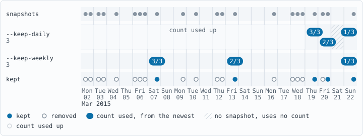

| Snapshot | Result | Reason |
|---|---|---|
| Sun 22 Mar 18:00 | kept | `daily snapshot`, `weekly snapshot` |
| Fri 20 Mar 18:00 | kept | `daily snapshot` |
| Fri 20 Mar 09:00 | removed | |
| Thu 19 Mar 18:00 | kept | `daily snapshot` |
| Wed 18 Mar 18:00 | removed | |
| Wed 18 Mar 13:00 | removed | |
| Wed 18 Mar 08:00 | removed | |
| Mon 16 Mar 18:00 | removed | |
| Fri 13 Mar 18:00 | kept | `weekly snapshot` |
| Thu 12 Mar 18:00 | removed | |
| Thu 12 Mar 09:00 | removed | |
| Tue 10 Mar 18:00 | removed | |
| Mon 09 Mar 18:00 | removed | |
| Sat 07 Mar 18:00 | kept | `weekly snapshot` |
| Fri 06 Mar 23:00 | removed | |
| Fri 06 Mar 18:00 | removed | |
| Fri 06 Mar 12:00 | removed | |
| Wed 04 Mar 18:00 | removed | |
| Tue 03 Mar 18:00 | removed | |
| Tue 03 Mar 09:00 | removed | |
| Mon 02 Mar 18:00 | removed | |
| Mon 02 Mar 09:00 | removed | |

`--keep-daily 3 --keep-weekly 3` keeps Sun 22 Mar 18:00, Fri 20 Mar 18:00, Thu 19 Mar 18:00, Fri 13 Mar 18:00 and Sat 07 Mar 18:00 and removes 17 other snapshots. `--keep-daily 3` keeps Sun 22 Mar 18:00, Fri 20 Mar 18:00 and Thu 19 Mar 18:00. `--keep-weekly 3` keeps Sun 22 Mar 18:00, Fri 13 Mar 18:00 and Sat 07 Mar 18:00. Sun 22 Mar 18:00 is kept by both rules and uses a count of each.

### Keep tag with a counted rule

`--keep-tag` adds the snapshots it keeps to what the other rules keep. It takes nothing out of their counts. A tagged snapshot that a counted rule reaches still uses a count of that rule, so a tagged snapshot among the newest leaves `--keep-last` one slot fewer for the others.

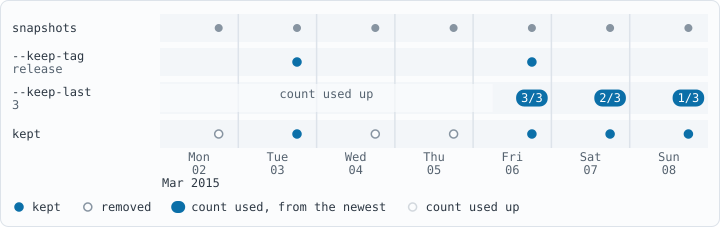

| Snapshot | Result | Reason |
|---|---|---|
| Sun 08 Mar 18:00 | kept | `last snapshot` |
| Sat 07 Mar 18:00 | kept | `last snapshot` |
| Fri 06 Mar 18:00 | kept | `has tags [release]`, `last snapshot` |
| Thu 05 Mar 18:00 | removed | |
| Wed 04 Mar 18:00 | removed | |
| Tue 03 Mar 18:00 | kept | `has tags [release]` |
| Mon 02 Mar 18:00 | removed | |

`--keep-tag release --keep-last 3` keeps Sun 08 Mar 18:00, Sat 07 Mar 18:00, Fri 06 Mar 18:00 and Tue 03 Mar 18:00 and removes 3 other snapshots. Fri 06 Mar 18:00 carries the tag and still uses a slot of `--keep-last 3`.

### A long-horizon recipe

`--keep-daily 7 --keep-weekly 4 --keep-monthly 12 --keep-yearly unlimited` keeps the newest snapshot of each of the 7 most recent days, 4 most recent weeks, 12 most recent months and all years that have one. The history reaches back more than a year and a half, with backups that thin out with age: one a month at first, then one a week, then one a day.

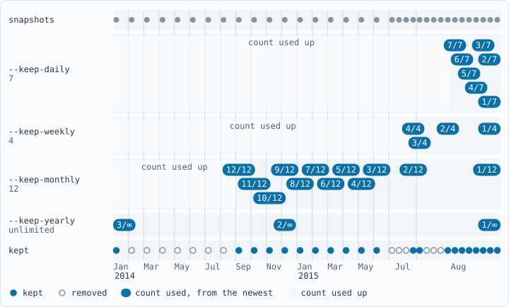

| Snapshot | Result | Reason |
|---|---|---|
| Sun 23 Aug 2015 18:00 | kept | `daily snapshot`, `weekly snapshot`, `monthly snapshot`, `yearly snapshot` |
| Sat 22 Aug 2015 18:00 | kept | `daily snapshot` |
| Fri 21 Aug 2015 18:00 | kept | `daily snapshot` |
| Thu 20 Aug 2015 18:00 | kept | `daily snapshot` |
| Wed 19 Aug 2015 18:00 | kept | `daily snapshot` |
| Tue 18 Aug 2015 18:00 | kept | `daily snapshot` |
| Mon 17 Aug 2015 18:00 | kept | `daily snapshot` |
| Sun 16 Aug 2015 18:00 | kept | `weekly snapshot` |
| Sat 15 Aug 2015 18:00 | removed | |
| Fri 14 Aug 2015 18:00 | removed | |
| Mon 10 Aug 2015 18:00 | removed | |
| Mon 03 Aug 2015 18:00 | kept | `weekly snapshot` |
| Mon 27 Jul 2015 18:00 | kept | `weekly snapshot`, `monthly snapshot` |
| Mon 20 Jul 2015 18:00 | removed | |
| Mon 13 Jul 2015 18:00 | removed | |
| Mon 06 Jul 2015 18:00 | removed | |
| Mon 01 Jun 2015 18:00 | kept | `monthly snapshot` |
| Mon 04 May 2015 18:00 | kept | `monthly snapshot` |
| Mon 06 Apr 2015 18:00 | kept | `monthly snapshot` |
| Mon 02 Mar 2015 18:00 | kept | `monthly snapshot` |
| Mon 02 Feb 2015 18:00 | kept | `monthly snapshot` |
| Mon 05 Jan 2015 18:00 | kept | `monthly snapshot` |
| Mon 01 Dec 2014 18:00 | kept | `monthly snapshot`, `yearly snapshot` |
| Mon 03 Nov 2014 18:00 | kept | `monthly snapshot` |
| Mon 06 Oct 2014 18:00 | kept | `monthly snapshot` |
| Mon 01 Sep 2014 18:00 | kept | `monthly snapshot` |
| Mon 04 Aug 2014 18:00 | removed | |
| Mon 07 Jul 2014 18:00 | removed | |
| Mon 02 Jun 2014 18:00 | removed | |
| Mon 05 May 2014 18:00 | removed | |
| Mon 07 Apr 2014 18:00 | removed | |
| Mon 03 Mar 2014 18:00 | removed | |
| Mon 03 Feb 2014 18:00 | removed | |
| Mon 06 Jan 2014 18:00 | kept | `oldest yearly snapshot` |

`--keep-daily 7 --keep-weekly 4 --keep-monthly 12 --keep-yearly unlimited` keeps Sun 23 Aug 2015 18:00, Sat 22 Aug 2015 18:00, Fri 21 Aug 2015 18:00, Thu 20 Aug 2015 18:00, Wed 19 Aug 2015 18:00, Tue 18 Aug 2015 18:00, Mon 17 Aug 2015 18:00, Sun 16 Aug 2015 18:00, Mon 03 Aug 2015 18:00, Mon 27 Jul 2015 18:00, Mon 01 Jun 2015 18:00, Mon 04 May 2015 18:00, Mon 06 Apr 2015 18:00, Mon 02 Mar 2015 18:00, Mon 02 Feb 2015 18:00, Mon 05 Jan 2015 18:00, Mon 01 Dec 2014 18:00, Mon 03 Nov 2014 18:00, Mon 06 Oct 2014 18:00, Mon 01 Sep 2014 18:00 and Mon 06 Jan 2014 18:00 and removes 13 other snapshots.


- `--keep-daily 7` keeps Sun 23 Aug 2015 18:00, Sat 22 Aug 2015 18:00, Fri 21 Aug 2015 18:00, Thu 20 Aug 2015 18:00, Wed 19 Aug 2015 18:00, Tue 18 Aug 2015 18:00 and Mon 17 Aug 2015 18:00.
- `--keep-weekly 4` keeps Sun 23 Aug 2015 18:00, Sun 16 Aug 2015 18:00, Mon 03 Aug 2015 18:00 and Mon 27 Jul 2015 18:00.
- `--keep-monthly 12` keeps Sun 23 Aug 2015 18:00, Mon 27 Jul 2015 18:00, Mon 01 Jun 2015 18:00, Mon 04 May 2015 18:00, Mon 06 Apr 2015 18:00, Mon 02 Mar 2015 18:00, Mon 02 Feb 2015 18:00, Mon 05 Jan 2015 18:00, Mon 01 Dec 2014 18:00, Mon 03 Nov 2014 18:00, Mon 06 Oct 2014 18:00 and Mon 01 Sep 2014 18:00.
- `--keep-yearly unlimited` keeps Sun 23 Aug 2015 18:00, Mon 01 Dec 2014 18:00 and Mon 06 Jan 2014 18:00, the last for an `oldest` reason.

## Comparisons

Rules that sound alike can keep different snapshots. Each timeline below runs two policies on the same history, one lane each. The table shows what each keeps.

### Keep daily or keep within daily

`--keep-daily 7` and `--keep-within-daily 7d` both keep one snapshot a day. `--keep-daily 7` counts days that have a snapshot, so it reaches back past days without one until it has found 7. `--keep-within-daily 7d` looks only at the 7 days before the newest snapshot, whatever they hold.

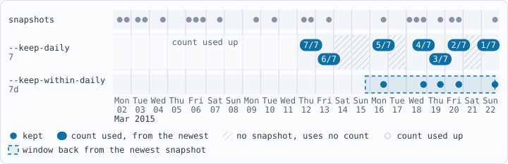

| Snapshot | `--keep-daily 7` | `--keep-within-daily 7d` |
|---|---|---|
| Sun 22 Mar 18:00 | `daily snapshot` | `daily within 7d` |
| Fri 20 Mar 18:00 | `daily snapshot` | `daily within 7d` |
| Fri 20 Mar 09:00 | removed | removed |
| Thu 19 Mar 18:00 | `daily snapshot` | `daily within 7d` |
| Wed 18 Mar 18:00 | `daily snapshot` | `daily within 7d` |
| Wed 18 Mar 13:00 | removed | removed |
| Wed 18 Mar 08:00 | removed | removed |
| Mon 16 Mar 18:00 | `daily snapshot` | `daily within 7d` |
| Fri 13 Mar 18:00 | `daily snapshot` | removed |
| Thu 12 Mar 18:00 | `daily snapshot` | removed |
| Thu 12 Mar 09:00 | removed | removed |
| Tue 10 Mar 18:00 | removed | removed |
| Mon 09 Mar 18:00 | removed | removed |
| Sat 07 Mar 18:00 | removed | removed |
| Fri 06 Mar 23:00 | removed | removed |
| Fri 06 Mar 18:00 | removed | removed |
| Fri 06 Mar 12:00 | removed | removed |
| Wed 04 Mar 18:00 | removed | removed |
| Tue 03 Mar 18:00 | removed | removed |
| Tue 03 Mar 09:00 | removed | removed |
| Mon 02 Mar 18:00 | removed | removed |
| Mon 02 Mar 09:00 | removed | removed |

`--keep-daily 7` keeps 7 snapshots, among them Fri 13 Mar 18:00 and Thu 12 Mar 18:00, which `--keep-within-daily 7d` does not keep. `--keep-within-daily 7d` keeps 5 snapshots. No snapshot falls on Sat 21 Mar, Tue 17 Mar, Sun 15 Mar and Sat 14 Mar: `--keep-daily 7` uses no count for them, while those inside the window of `--keep-within-daily 7d` take up part of it. The window starts at Sun 15 Mar 18:00.

### Keep last or keep within

`--keep-last 7` counts snapshots, `--keep-within 7d` measures time. Where backups are frequent, the last 7 snapshots span less than 7 days; where they are sparse, more.

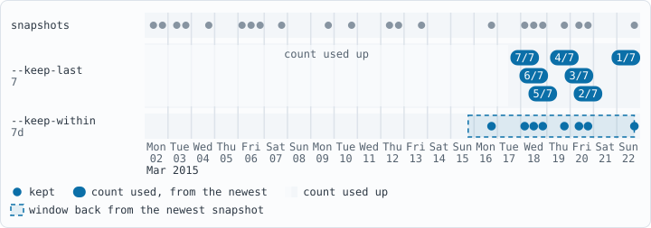

| Snapshot | `--keep-last 7` | `--keep-within 7d` |
|---|---|---|
| Sun 22 Mar 18:00 | `last snapshot` | `within 7d` |
| Fri 20 Mar 18:00 | `last snapshot` | `within 7d` |
| Fri 20 Mar 09:00 | `last snapshot` | `within 7d` |
| Thu 19 Mar 18:00 | `last snapshot` | `within 7d` |
| Wed 18 Mar 18:00 | `last snapshot` | `within 7d` |
| Wed 18 Mar 13:00 | `last snapshot` | `within 7d` |
| Wed 18 Mar 08:00 | `last snapshot` | `within 7d` |
| Mon 16 Mar 18:00 | removed | `within 7d` |
| Fri 13 Mar 18:00 | removed | removed |
| Thu 12 Mar 18:00 | removed | removed |
| Thu 12 Mar 09:00 | removed | removed |
| Tue 10 Mar 18:00 | removed | removed |
| Mon 09 Mar 18:00 | removed | removed |
| Sat 07 Mar 18:00 | removed | removed |
| Fri 06 Mar 23:00 | removed | removed |
| Fri 06 Mar 18:00 | removed | removed |
| Fri 06 Mar 12:00 | removed | removed |
| Wed 04 Mar 18:00 | removed | removed |
| Tue 03 Mar 18:00 | removed | removed |
| Tue 03 Mar 09:00 | removed | removed |
| Mon 02 Mar 18:00 | removed | removed |
| Mon 02 Mar 09:00 | removed | removed |

`--keep-last 7` keeps 7 snapshots. `--keep-within 7d` keeps 8 snapshots, among them Mon 16 Mar 18:00, which `--keep-last 7` does not keep. The window starts at Sun 15 Mar 18:00.

### Keep daily or keep hourly

With several backups a day, `--keep-hourly 4` keeps the newest snapshot of each of the 4 most recent hours that have one, while `--keep-daily 4` keeps one snapshot from each of 4 days. The history is four days with three backups each.

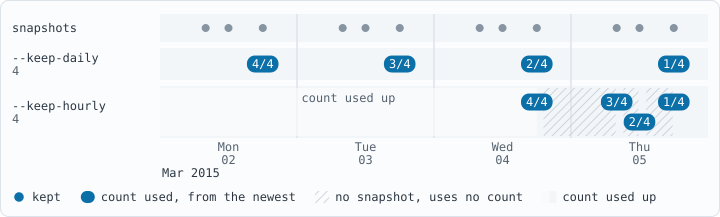

| Snapshot | `--keep-daily 4` | `--keep-hourly 4` |
|---|---|---|
| Thu 05 Mar 18:00 | `daily snapshot` | `hourly snapshot` |
| Thu 05 Mar 12:00 | removed | `hourly snapshot` |
| Thu 05 Mar 08:00 | removed | `hourly snapshot` |
| Wed 04 Mar 18:00 | `daily snapshot` | `hourly snapshot` |
| Wed 04 Mar 12:00 | removed | removed |
| Wed 04 Mar 08:00 | removed | removed |
| Tue 03 Mar 18:00 | `daily snapshot` | removed |
| Tue 03 Mar 12:00 | removed | removed |
| Tue 03 Mar 08:00 | removed | removed |
| Mon 02 Mar 18:00 | `daily snapshot` | removed |
| Mon 02 Mar 12:00 | removed | removed |
| Mon 02 Mar 08:00 | removed | removed |

`--keep-daily 4` keeps 4 snapshots, among them Tue 03 Mar 18:00 and Mon 02 Mar 18:00, which `--keep-hourly 4` does not keep. `--keep-hourly 4` keeps 4 snapshots, among them Thu 05 Mar 12:00 and Thu 05 Mar 08:00, which `--keep-daily 4` does not keep.
## Time zones

ark counts hours, days, weeks, months, and years in the local time zone of the machine that runs `ark forget`. The machine that made the backup doesn't matter.

- A backup at 00:30 local time belongs to the new day.
- A week is an ISO week and starts on Monday.
- `--keep-last` doesn't depend on the zone. Of a `--keep-within` duration, only the hours don't.

Set `TZ` to count in another zone:

```bash
TZ=UTC ark forget --keep-daily 7
```

## Snapshots dated in the future

A snapshot can carry a date that is later than the time `ark forget` runs. A machine with a wrong clock produces one, and so can an imported archive.

ark keeps such a snapshot, whatever the policy says, and leaves it out of every rule:

- No rule counts it, no period takes it, and no window starts at it. The other snapshots are decided as if it weren't there.
- Its reason in `--json` is `in the future`, also when its tags match a `--keep-tag` list.
- It doesn't count as a kept snapshot of its series. A policy that keeps nothing else of the series is still refused.
- A policy run warns about each one on stderr, with `--dry-run` too. When the run is refused, the error names the snapshots instead.

The snapshot stays until its date has passed. From then on, the rules see it like any other. To remove it earlier, name its ID: `ark forget <id>`.

The time of the run is taken from the repository's clock, the one its locks use, and read once per run.

restic handles this differently. It counts such a snapshot in its rules, so the two tools keep different snapshots of a series that holds one.

## Concurrent runs

`ark forget` takes the repository's exclusive lock, also when it removes snapshots by ID. Two forgets never decide from the same listing, so two runs with different policies can't remove between them what each one keeps. The later run decides from what the earlier one left, and a policy that keeps nothing of a series is refused there as in any run. A forget that can't get the lock exits 3 and removes nothing.

The lock also keeps a forget out while a backup runs. A scheduled `forget` that may overlap a backup or another forget needs `--lock-wait`, for example `--lock-wait 30m`; without it, the run fails at once. `--dry-run` removes nothing and takes the shared lock, so it runs beside backups.

## Details: calendar steps

The years, months, and days of a duration are stepped back on the calendar of the local time zone. Hours are elapsed time. Most of the time you won't notice the difference. These are the cases where you do:

| Case | Result |
|---|---|
| `1m` back from 15 March | 15 February |
| `1m` back from 31 March | 3 March, or 2 March in a leap year: February has no 31st, so the step runs over into the next month |
| `1d` back across the start of daylight saving time | 23 hours, where `24h` is always 24 |
| a step onto a time that the clocks skip when daylight saving time starts | an hour before or after that time |

`--json` writes a `within` reason unit by unit, as the duration was given: `within 72h`, not `within 3d`. Numbers are written plainly, so `030d` reads `within 30d`.

restic counts and writes durations the same way.
